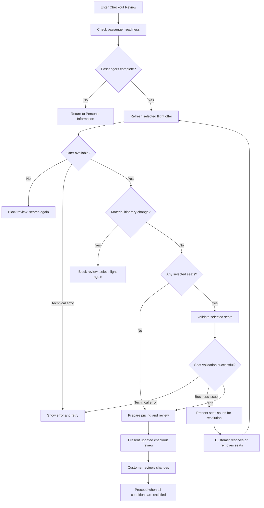

# BR-05: Checkout Review Contract

**Status:** Approved design direction; implementation not started  
**Scope:** Provider-agnostic passenger domain model and passenger-information collection for the current one-way booking flow  
**Depends on:** BR-01 checkout contract, BR-02 offer refresh/validation, BR-03 seat-service validation, BR-04A passenger domain model, BR-04B multi-passenger UI
**Explicitly excludes:** Order creation, payment processing, booking confirmation, saved-traveller profiles, and persistent passenger-data storage

## 1. Purpose and objectives

### 1.1 Purpose

BR-05 introduces a Checkout Review stage between passenger information and the future order-creation/payment process.

Its purpose is to give the customer an opportunity to inspect the complete booking information and confirm that the flight, passengers, selected seats and prices are correct before proceeding.

Unlike a conventional summary screen, Checkout Review must use freshly validated provider information.

The screen must not rely exclusively on the flight and seat information originally retrieved during flight selection.

### 1.2 Objectives

BR-05 must:

1. Present the complete flight itinerary, including connecting segments.
2. Present all passengers and their relevant booking information.
3. Associate selected seats with their respective passengers and flight segments.
4. Refresh the selected flight offer before presenting the final review.
5. Revalidate selected seats against current provider information.
6. Present any changes to flight and seat prices transparently.
7. Require explicit customer acceptance of changed prices.
8. Prevent progression when the flight, seats or required booking information are not in an acceptable state.
9. Provide understandable error handling and recovery when provider requests fail.
10. Produce a validated review state that can serve as the input boundary for BR-06.

### 1.3 Success condition

BR-05 is successful when the customer can reach a state in which:

- The selected flight offer has been successfully refreshed.
- The itinerary remains compatible with the original selection.
- All selected seats have been validated, or there are no selected seats.
- Passenger information is complete.
- All applicable price changes have been explicitly accepted.
- The customer can see the complete updated pricing breakdown.
- The customer can proceed to the next stage.

This state does not represent a booking or reservation.

## 2. Scope and boundaries

### 2.1 Included in BR-05

| Area             | Responsibility                                                     |
| ---------------- | ------------------------------------------------------------------ |
| Itinerary review | Display the complete refreshed journey and its flight segments     |
| Passenger review | Display passenger information already collected and validated      |
| Seat review      | Display selected seats alongside passengers and segments           |
| Offer validation | Retrieve and compare the current offer                             |
| Seat validation  | Revalidate existing seat selections                                |
| Price comparison | Compare original and refreshed price components                    |
| Price acceptance | Record explicit acceptance of changed prices                       |
| Pricing summary  | Calculate and display the updated total                            |
| Error handling   | Handle provider failures, retries and blocked states               |
| Navigation       | Support returning to passenger or seat selection where appropriate |

### 2.2 Explicitly excluded

The following responsibilities belong to future milestones or other product areas.

- Creating a Duffel order.
- Authorizing or capturing payment.
- Storing payment-card information.
- Issuing tickets.
- Confirming a booking.
- Reserving seats.
- Creating persistent passenger profiles.
- Implementing a general-purpose booking-management system.
- Introducing unsupported ancillary services or charges.

**Important:** A successful Checkout Review must not be interpreted as a successful booking.

BR-06 will define what happens after the customer proceeds from this screen.

## Entry requirements

Checkout Review should only be accessible when the customer has completed the preceding stages.

The expected navigation is:

**Flight Results**

**Flight Details**

**Choose Seat**

**Personal Information**

**Checkout Review (BR-05)**

**Future BR-06 boundary**

Order creation and payment lifecycle

### Required entry conditions

Before entering Checkout Review:

- A selected flight offer must exist.
- The booking session must be valid.
- A passenger collection must exist.
- Every required passenger field must be complete and valid.
- Passenger relationships must be valid.
- Passenger information must satisfy the applicable provider requirements.
- Any selected seats must have valid references to their respective passengers and flight segments.

The existing BR-04 readiness model should be reused.

The expected readiness state is:

`ready_for_order_preparation`

However, this remains a passenger-information readiness state. It does not establish that the flight offer or seat selections are currently valid.

### Passenger validation responsibility

Passenger validation belongs primarily to the Personal Information stage.

The customer must not be allowed to continue from Personal Information while required information is incomplete or invalid.

Checkout Review should still defensively verify the passenger collection before proceeding. This protects against stale or inconsistent in-memory state.

It must not become a replacement for the passenger validation implemented in BR-04.

## 4. Checkout Review information architecture

The screen will contain four primary information sections:

1. Itinerary.
2. Passengers.
3. Seats.
4. Pricing.

These sections should be presented in a logical reading order, with important changes clearly visible.

### 4.1 Itinerary section

The itinerary section must represent the complete journey, not just the departure and final arrival airports.

For direct flights, display the single flight segment.

For connecting flights, display each segment independently while retaining the complete journey as one itinerary.

#### Required information

For each flight segment:

- Airline name.
- Airline logo, where available.
- Flight number.
- Operating carrier, where different and available.
- Departure airport and airport code.
- Arrival airport and airport code.
- Departure date and local time.
- Arrival date and local time.
- Segment duration.
- Relevant cabin/class information, where available.

For connections:

- Connection airport.
- Layover duration.
- Connection sequence.
- Any available provider-supplied connection information.

#### Example

**Lagos to Dubai** (1 connection)

**Segment 1 · Airline and flight number**

**08:30**

**LOS**

Lagos

4h 30m

---

**13:00**

**ADD**

Addis Ababa

Layover · 2h 15m

**Segment 2 · Airline and flight number**

**15:15**

**ADD**

Addis Ababa

5h 20m

---

**20:35**

**DXB**

Dubai

Illustrative data only.

The actual implementation must use provider data rather than hardcoded itinerary assumptions.

#### Itinerary change handling

The refreshed offer must be compared with the originally selected offer.

Material changes include changes that affect the actual journey, such as:

- Departure or arrival airports.
- Flight segments.
- Segment sequence.
- Departure or arrival dates.
- Departure or arrival times.
- Connection structure.
- Other material itinerary characteristics.

If a material itinerary change is detected:

- The customer must not proceed.
- The new itinerary must not silently replace the original selection.
- The customer must be informed that the selected flight has changed.
- The customer must return to flight search/results and select an offer again.
  Harmless descriptive changes should not automatically invalidate the offer. This preserves the existing BR-02 comparison rules.

### 4.2 Passenger section

Every passenger must be presented individually.

The section should clearly distinguish between adults, children and infants.

#### Information to display

Subject to the data available and relevant requirements:

- Passenger type.
- Title, where applicable.
- First and middle names.
- Last name.
- Date of birth.
- Gender, where applicable.
- Nationality, where applicable.
- Travel document type.
- Document expiry date, where relevant.

Sensitive document numbers should not be unnecessarily exposed. Where a document identifier must be shown for customer verification, use a masked representation.

#### Passenger relationships

Where an infant is associated with a responsible adult, the relationship should be represented clearly.

The review must not infer passenger relationships from array positions or other accidental ordering.

Use the existing BR-04 passenger-domain relationships.

#### Incomplete information

Incomplete passenger information should be prevented at the Personal Information stage.

If Checkout Review nevertheless encounters an incomplete or invalid collection:

- The review must be blocked.
- The customer should be directed back to Personal Information.
- Existing passenger data should be preserved.
- The customer should be shown what needs correction.

No order-preparation progression is permitted with incomplete passenger information.

### 4.3 Seat section

Seats must be displayed within the context of the passengers who selected them.

A separate, disconnected list of selected seats is not sufficient.

#### Display requirements

For each passenger:

- Show their selected seat, if any.
- Associate it with the correct flight segment.
- Show the seat-selection status.
- Show the applicable price.
- Show relevant disclosures, where applicable.

A passenger without a selected seat should not have an empty seat section displayed.

#### Connecting-flight seats

A passenger can have different seats on different flight segments.

Therefore, seat information must retain its segment association.

Example:

| Passenger | Segment   | Seat | Status      |
| --------- | --------- | ---- | ----------- |
| Adult 1   | LOS → ADD | 12A  | Available   |
| Adult 1   | ADD → DXB | 14C  | Available   |
| Adult 2   | LOS → ADD | 12B  | Unavailable |
| Adult 2   | ADD → DXB | 14D  | Available   |

#### Seat validation outcomes

BR-03 remains authoritative for the seat-service validation contract.

The review should account for its outcomes:

| Outcome             | Checkout Review behaviour                                            |
| ------------------- | -------------------------------------------------------------------- |
| `valid`             | Display the selected seat as available                               |
| `price_changed`     | Display updated seat price and request acceptance                    |
| `selection_changed` | Present the changed selection/disclosure and require customer review |
| `not_selected`      | Do not present a selected seat as valid                              |
| Technical failure   | Block progression and offer retry                                    |

Where a selected seat is unavailable, the customer must be able to:

- Return to seat selection and choose another seat.
- Remove the seat selection and continue without it, where permitted.

An unavailable seat must never silently be removed.

#### Important boundary

A successful seat validation is not a seat reservation.

BR-05 only confirms that the selected seat service remains valid according to the latest provider response.

### 4.4 Pricing section

Pricing must be presented as a consolidated breakdown.

The customer should be able to understand what contributes to the total payable amount.

#### Required components

| Component           | Description                              |
| ------------------- | ---------------------------------------- |
| Flight fare         | Combined flight price for all passengers |
| Seat selection      | Combined price of selected seats         |
| Additional services | Applicable supported add-ons, if any     |
| Total payable       | Sum of all current validated components  |

Additional services must only appear when the product actually supports and includes them.

#### Original versus refreshed prices

Where a component has changed, show:

- Original amount.
- Updated amount.
- Difference.
- Percentage change, where meaningful.

Example:

| Component           | Original       | Updated        |
| ------------------- | -------------- | -------------- |
| Flight fare         | ~~₦1,700,000~~ | ₦1,840,000     |
| Seat selection      | ~~₦60,000~~    | ₦80,000        |
| Additional services | ₦25,000        | ₦25,000        |
| **Total payable**   |                | **₦1,945,000** |

The total must be calculated from the latest validated component amounts.

The original total may optionally be shown as a reference, but the updated total is the amount the customer is reviewing.

#### Financial correctness

The following rules are mandatory:

1. Provider-returned prices are authoritative.
2. Original prices are retained for comparison only.
3. Monetary amounts must preserve their original decimal precision.
4. Financial calculations must not rely on unsafe floating-point arithmetic.
5. Currency must be consistent across all components included in the total.
6. A currency change must be treated as a material pricing change and require explicit acceptance.
7. The application must never reconstruct authoritative amounts from rounded display values.

The existing `FlightOffer` type discrepancy involving `priceAmount` must be resolved as part of the integration work. The provider's original amount string must remain available.

## 5. Validation lifecycle

This is one of the most important parts of BR-05.

Entering Checkout Review must trigger fresh validation before the customer receives a completed review.

### 5.1 Validation sequence



The sequence establishes that the selected offer must be successfully refreshed before seat validation begins.

If the flight offer is unavailable or the itinerary has materially changed, seat validation must not continue.

If there are no selected seats, the seat-validation request can be skipped.

### 5.2 Offer refresh

Reuse the existing BR-02 backend action:

`refresh-offer`

The client integration must:

- Send the selected provider offer identifier.
- Supply the original offer snapshot for comparison.
- Receive the refreshed provider result.
- Interpret business outcomes separately from technical failures.
- Preserve the refreshed provider data for the review.

The client must not treat its original snapshot as the current authoritative offer.

#### Outcomes

| Outcome             | Result                                           |
| ------------------- | ------------------------------------------------ |
| `valid`             | Continue validation                              |
| `price_changed`     | Continue with updated price requiring acceptance |
| `itinerary_changed` | Block and return to flight selection             |
| `unavailable`       | Block and return to search                       |

Technical failures must remain distinguishable from these business outcomes.

### 5.3 Seat validation

Only after successful offer validation should selected seats be validated.

Reuse the existing BR-03 backend action and client contract.

The validation must use:

- Current offer ID.
- Selected segment ID.
- Selected seat designator.
- Service ID.
- Correct provider passenger ID.
- Current provider price and currency.
- Applicable disclosures.

The result must be associated with the exact seat selection that was submitted.

### 5.4 Passenger readiness

Use the existing BR-04 readiness logic.

Passenger readiness should be checked before the provider requests and again before allowing progression if the passenger collection has changed.

Do not create a second passenger-readiness implementation specifically for BR-05.

## 6. Price-change acceptance contract

Price acceptance must be explicit, independently tracked and tied to the exact validated price component.

This is necessary because a customer may accept a flight-price change but subsequently change a seat and encounter a different seat price.

### 6.1 Acceptance granularity

Acceptance must be tracked separately for:

- Flight fare.
- Seat selection.
- Additional services, if supported and included.

A single generic `accepted: true` flag for the entire review is insufficient.

### 6.2 Flight price acceptance

When the refreshed flight fare differs from the original fare:

1. Display the original fare.
2. Display the updated fare.
3. Display the difference and percentage change where meaningful.
4. Require explicit customer acceptance.
5. Do not allow progression until accepted.

If the refreshed flight fare changes again, previous acceptance becomes invalid.

### 6.3 Seat price acceptance

The same rules apply to selected seat services.

If a seat is replaced or its price changes:

- The relevant seat selection must be validated again.
- Its current price must be displayed.
- Acceptance must be requested for the new price.

Acceptance for an unrelated seat or previous seat selection must not carry over.

### 6.4 Independent acceptance preservation

Consider this sequence:

1. Flight fare increases from ₦850,000 to ₦920,000.
2. Customer accepts the updated flight fare.
3. Customer changes a selected seat.
4. The replacement seat costs more.
5. The customer reviews and accepts the updated seat price.

The previous flight-fare acceptance remains valid provided the refreshed flight offer has not changed again.

The replacement seat requires its own acceptance.

### 6.5 Acceptance validity

Acceptance must be bound to the exact validated component data.

At minimum, the application must be able to establish:

- Which component was accepted.
- The applicable offer or seat-selection identity.
- The validated amount.
- The currency.
- The underlying version or fingerprint of the validated component.

If any underlying data that affects an accepted amount changes, the associated acceptance becomes invalid.

The customer must then review and accept the new amount.

**Important:** Acceptance must not be inferred from simply opening the review screen, navigating away and returning, or pressing the final proceed button without seeing the changed price.

## 7. Review state and progression rules

BR-05 should have a clear state model rather than relying on scattered screen booleans.

### 7.1 Proposed review states

| State              | Meaning                                                                            |
| ------------------ | ---------------------------------------------------------------------------------- |
| `initializing`     | Checking booking session and passenger readiness                                   |
| `refreshing_offer` | Retrieving the latest offer                                                        |
| `validating_seats` | Validating selected seat services                                                  |
| `ready_for_review` | All required validation has completed                                              |
| `action_required`  | Customer must accept a price change or resolve a seat issue                        |
| `blocked`          | Offer unavailable, itinerary changed or another non-recoverable business condition |
| `error`            | A technical failure prevented validation                                           |

These states describe the review lifecycle.

They should not replace the more granular results returned by the existing provider contracts.

### 7.2 Conditions for proceeding

The customer may proceed only when all of the following are true:

#### Checkout progression requirements

Passenger information is complete and valid.

Flight offer has been successfully refreshed.

Itinerary remains compatible with the original selection.

Selected seats have been successfully validated, or no seats are selected.

All changed price components have been accepted.

No unresolved seat availability or disclosure issues remain.

The pricing breakdown is internally consistent.

A customer must never proceed based on an old successful validation result when the underlying booking data has changed.

## 8. Error handling and recovery

BR-05 must distinguish business outcomes from technical failures.

This is particularly important because an expired offer is not the same thing as an unavailable network connection.

### 8.1 Error classification

| Situation                    | Classification   | Customer action                    |
| ---------------------------- | ---------------- | ---------------------------------- |
| Offer expired or unavailable | Business outcome | Return to search                   |
| Material itinerary change    | Business outcome | Select another flight              |
| Selected seat unavailable    | Business outcome | Change or remove seat              |
| Flight price changed         | Review action    | Accept or abandon                  |
| Seat price changed           | Review action    | Accept or change seat              |
| Changed seat disclosure      | Review action    | Review and acknowledge             |
| Network failure              | Technical error  | Retry                              |
| Provider timeout             | Technical error  | Retry                              |
| Malformed provider response  | Technical error  | Retry, then exit review            |
| Unexpected internal error    | Technical error  | Show safe error and allow recovery |

### 8.2 Retry policy

For provider requests that fail technically:

- The initial attempt counts as attempt one.
- The customer may retry up to two additional times.
- This gives a maximum of three attempts for the affected validation operation during that review attempt.

After three failed attempts:

- Explain that the flight information could not be verified.
- Prevent progression.
- Provide an option to return to search and start again.
- Preserve the booking draft where practical.

Reaching the retry limit must not automatically erase passenger information or cancel a provider booking. At this stage, no order has been created.

A fresh review attempt should be able to start a new retry cycle.

### 8.3 Retry granularity

A failed offer refresh must be retried as an offer refresh.

A failed seat validation must be retried as a seat validation, provided the offer remains valid and unchanged.

Do not unnecessarily repeat successful provider requests when their underlying data remains unchanged and their results are still valid.

## 9. Navigation and data invalidation

Navigation must preserve the customer's work while ensuring that stale validation results cannot be reused.

### 9.1 Navigation behaviour

| Customer action                  | Expected behaviour                                                |
| -------------------------------- | ----------------------------------------------------------------- |
| Enter Checkout Review            | Trigger fresh validation                                          |
| Return to Personal Information   | Preserve passenger information                                    |
| Return to Seat Selection         | Preserve existing selections until changed                        |
| Change passenger information     | Re-evaluate passenger readiness                                   |
| Change a seat                    | Invalidate relevant seat validation                               |
| Remove a seat                    | Invalidate relevant seat validation                               |
| Change flight offer              | Invalidate offer, seat validation and associated price acceptance |
| Return to review without changes | Reuse only results that remain valid under freshness rules        |

### 9.2 Validation invalidation

The following rules are mandatory:

#### Passenger changes

- Re-evaluate passenger readiness.
- Do not automatically invalidate the flight offer if the selected offer has not changed.
- Do not automatically invalidate seat validation if seat selections and passenger provider identities remain unchanged.

#### Seat changes

- Invalidate validation for the changed seat selection.
- Revalidate the updated selection before proceeding.
- Preserve unrelated valid acceptance decisions.

#### Offer changes

- Invalidate previous offer validation.
- Invalidate seat validation associated with the previous offer.
- Invalidate price acceptance associated with the previous offer.
- Restart the necessary review validation sequence.

### 9.3 Freshness and stale-result protection

Validation results must be associated with the exact booking state against which they were obtained.

At minimum, the implementation should use a combination of:

- Booking-session identity.
- Selected offer identity and version.
- Passenger collection revision where relevant.
- Seat-selection revision.
- Validated component identity.

A validation result must not be considered current merely because it exists in Zustand.

The implementation must also guard against overlapping asynchronous requests. For example, a response from an earlier review attempt must not overwrite results from a newer attempt.

## 10. Data and architectural responsibilities

This section defines where BR-05 should obtain information and what it should own.

### 10.1 Existing responsibilities to reuse

| Existing component                               | BR-05 responsibility                        |
| ------------------------------------------------ | ------------------------------------------- |
| `src/lib/flights/api.ts`                         | Client-side flight and seat API integration |
| `src/lib/flights/types.ts`                       | Flight offer and related response types     |
| `src/store/flight-offers.store.ts`               | Selected offer and offer data               |
| `src/store/flight-booking.store.ts`              | Booking session and passenger/seat data     |
| `src/lib/booking/readiness/booking-readiness.ts` | Passenger readiness                         |
| `src/lib/booking/readiness/booking-session.ts`   | Booking-session lifecycle                   |
| `src/lib/booking/passengers/passenger-domain.ts` | Passenger collection and relationships      |
| Duffel passenger validation                      | Existing passenger requirement validation   |
| Appwrite flight-search function                  | Backend-only provider integration           |

### 10.2 Required integration gap

The deeper audit identified an important gap:

The backend already supports the BR-02 `refresh-offer` action, but the existing client API did not expose a corresponding `refreshOffer()` helper.

BR-05 must close this integration gap.

It must not implement a second offer-refresh backend action.

The client helper should follow the existing API integration conventions and return a typed result that distinguishes business outcomes from technical failures.

### 10.3 Flight price representation

The backend currently preserves the original provider price as `priceAmount`, but the existing `FlightOffer` TypeScript interface does not fully represent this field.

BR-05 integration must correct this discrepancy.

The original decimal amount string must remain available throughout the review and pricing calculations.

Do not use the rounded display number as the source for subsequent calculations.

### 10.4 Review-specific state

BR-05 will likely need review-specific state, but it should be minimal.

It should track information such as:

- Review attempt identity.
- Current validation lifecycle state.
- Latest successful offer refresh.
- Latest successful seat validation.
- Outstanding customer actions.
- Accepted price components.
- Relevant validation revisions.

The implementation must not duplicate the passenger domain or create a parallel booking store.

### 10.5 Provider security

All Duffel API requests must remain on the backend.

The mobile application must never:

- Call Duffel directly.
- Contain the Duffel API secret.
- Treat client-submitted prices as authoritative.
- Manufacture provider passenger IDs.
- Manufacture service IDs or seat availability.
- Treat local validation as a provider reservation.

The backend must continue validating and interpreting provider responses.

## 11. Review-to-BR-06 boundary

This boundary is especially important.

BR-05 should produce a structured, validated representation of the customer's reviewed booking.

Conceptually, this represents:

```ts
type CheckoutReviewReadiness = {
	bookingSessionId: string

	passengerReadiness: "ready_for_order_preparation"

	offer: {
		status: "valid"
		offerId: string
		validatedRevision: string
	}

	seats: {
		status: "valid" | "not_selected"
		validatedRevision?: string
	}

	priceAcceptance: {
		status: "complete"
		acceptedComponents: string[]
	}

	pricing: {
		currency: string
		flightFare: string
		seatTotal: string
		additionalServicesTotal: string
		totalPayable: string
	}
}
```

This is an illustrative conceptual contract, not a declaration that these exact TypeScript types already exist or should be implemented verbatim.

BR-06 will need to define how this reviewed state is consumed, refreshed and verified during order preparation.

The important boundary is:

**BR-05 establishes that the customer has reviewed and accepted the latest validated booking information. BR-06 establishes how that information is safely turned into an order and payment lifecycle.**

BR-05 must not assume that its validation result guarantees the offer or seat remains available indefinitely.

## 12. Acceptance criteria

These are the proposed completion criteria for BR-05.

| ID      | Acceptance criterion                                                                                                    |
| ------- | ----------------------------------------------------------------------------------------------------------------------- |
| BR05-01 | Customer cannot enter Checkout Review with incomplete or invalid required passenger information.                        |
| BR05-02 | Checkout Review displays the complete itinerary.                                                                        |
| BR05-03 | Connecting flights display their individual segments and layovers.                                                      |
| BR05-04 | Passenger information is displayed individually and accurately.                                                         |
| BR05-05 | Selected seats appear under the correct passenger and flight segment.                                                   |
| BR05-06 | Passengers without selected seats do not display unnecessary seat information.                                          |
| BR05-07 | Entering Checkout Review triggers a fresh offer refresh.                                                                |
| BR05-08 | An unavailable offer blocks review progression and offers a return to search.                                           |
| BR05-09 | Material itinerary changes block progression and require flight reselection.                                            |
| BR05-10 | Harmless offer-description changes do not unnecessarily invalidate the offer.                                           |
| BR05-11 | Selected seats are revalidated after successful offer validation.                                                       |
| BR05-12 | Unavailable seats require customer intervention.                                                                        |
| BR05-13 | Changed seat prices are displayed and require explicit acceptance.                                                      |
| BR05-14 | Flight price changes are displayed with original and updated amounts and require explicit acceptance.                   |
| BR05-15 | Acceptance of one price component does not automatically accept another.                                                |
| BR05-16 | Acceptance remains valid only while its underlying component remains unchanged.                                         |
| BR05-17 | The pricing breakdown correctly combines flight fares, seat prices and supported additional services.                   |
| BR05-18 | The total payable amount is calculated from current validated component amounts.                                        |
| BR05-19 | Currency inconsistencies are handled safely and cannot produce an invalid combined total.                               |
| BR05-20 | Technical provider failures are distinguishable from business outcomes.                                                 |
| BR05-21 | Provider failures offer retry support, with a maximum of three attempts per affected operation during a review attempt. |
| BR05-22 | Exhausting retries blocks progression without automatically deleting the booking draft.                                 |
| BR05-23 | Returning to passenger information preserves existing passenger data.                                                   |
| BR05-24 | Changing a seat invalidates the relevant previous seat validation.                                                      |
| BR05-25 | Changing the selected offer invalidates dependent validation and price acceptance.                                      |
| BR05-26 | Old asynchronous validation responses cannot overwrite newer review state.                                              |
| BR05-27 | Review validation results cannot be reused across unrelated booking sessions.                                           |
| BR05-28 | No order, payment, ticket issuance or booking confirmation is created by BR-05.                                         |

## 13. Proposed implementation checkpoints

I recommend dividing BR-05 into five meaningful checkpoints.

The goal is to keep each checkpoint independently reviewable without turning the work into unnecessarily tiny tasks.

### Checkpoint 1: Review foundation (P1)

Establish the screen, navigation, entry conditions and review-specific state.

- Create Checkout Review route.
- Integrate it after Personal Information.
- Verify passenger readiness.
- Establish review-session identity and state lifecycle.
- Handle loading and initial error states.

  Exit: Customer reaches the review screen only with valid passenger information.

---

### Checkpoint 2: Fresh offer integration (P2)

Connect the existing BR-02 backend functionality to the mobile application.

- Add typed refreshOffer() client integration.
- Correct offer price typing.
- Implement offer comparison and outcome handling.
- Handle unavailable offers and itinerary changes.
- Add retry behaviour.

  Exit: Review uses current provider offer information and safely handles all offer outcomes.

---

### Checkpoint 3: Seat validation and passenger association (P3)

Integrate existing BR-03 validation with the review experience.

- Trigger validation after successful offer refresh.
- Associate results with passengers and segments.
- Present seat availability and changed disclosures.
- Handle unavailable seats and replacement/removal navigation.
- Invalidate stale seat validation.

  Exit: Every selected seat has an accurate, current review status.

---

### Checkpoint 4: Pricing and customer acceptance (P4)

Implement the complete pricing and acceptance contract.

- Consolidate flight and seat costs.
- Display original and updated amounts.
- Calculate total payable safely.
- Implement component-level price acceptance.
- Preserve valid acceptance when unrelated components change.

  Exit: Customer can understand and explicitly accept every applicable price change.

---

### Checkpoint 5: Integration and final verification (P5)

Verify the complete Checkout Review lifecycle.

- Test navigation and data preservation.
- Test validation invalidation.
- Test overlapping requests and stale responses.
- Test failure and recovery paths.
- Verify all BR05 acceptance criteria.
- Update project documentation.

  Exit: BR-05 is complete, verified and ready for an explicit merge decision.

Each checkpoint should be committed and pushed for your review. We should agree on its exact task breakdown before implementation, and no checkpoint should be merged without your approval.

## 14. Testing requirements

Testing must cover more than the happy path.

The following scenarios should be represented in the test suite.

| Scenario                                           | Expected result                                            |
| -------------------------------------------------- | ---------------------------------------------------------- |
| Direct flight, no selected seats                   | Review succeeds without seat validation                    |
| Connecting flight, seats selected on both segments | Each seat is correctly associated and validated            |
| Passenger has incomplete information               | Review entry blocked                                       |
| Offer is still valid with unchanged price          | Review proceeds                                            |
| Offer price increases                              | Updated price shown; acceptance required                   |
| Offer price decreases                              | Updated price shown; acceptance required                   |
| Offer expires                                      | Review blocked; return to search                           |
| Itinerary changes                                  | Review blocked; flight reselection required                |
| Seat becomes unavailable                           | Customer must resolve the selection                        |
| Seat price increases                               | New seat price displayed; acceptance required              |
| Seat disclosure changes                            | Customer must review changed disclosure                    |
| Flight accepted, seat later changed                | Flight acceptance preserved if its offer remains unchanged |
| Flight offer changes again                         | Previous flight-price acceptance invalidated               |
| Offer refresh fails                                | Retry offered                                              |
| Seat validation fails                              | Retry offered                                              |
| Three attempts fail                                | Progression blocked; draft preserved where practical       |
| Passenger details edited                           | Passenger readiness re-evaluated                           |
| Customer changes seat and returns                  | Stale seat validation is not reused                        |
| Old request responds after a new review attempt    | Old response ignored                                       |

Testing must also cover financial calculations, currency consistency, malformed provider responses and booking-session isolation.

## 15. Definition of done

BR-05 is complete when:

- All 28 acceptance criteria are satisfied.
- Existing BR-02, BR-03 and BR-04 behaviour remains intact.
- No duplicate provider validation implementation has been introduced.
- No Duffel secrets or direct provider requests have entered the mobile application.
- Financial calculations preserve monetary precision.
- The review lifecycle is protected against stale and overlapping requests.
- All relevant tests pass.
- TypeScript checks pass.
- Expo lint passes.
- Documentation reflects the implemented behaviour.
- Changes have been committed and pushed.
- You have reviewed and explicitly approved the final changes.

## 16. Important implementation constraints

Before we start, I want these constraints visible because they are the areas where an otherwise functional implementation could introduce architectural problems.

1. **Do not duplicate existing contracts.** BR-02 owns offer refresh; BR-03 owns seat-service validation; BR-04 owns passenger readiness and the passenger domain.
2. **Do not treat the Zustand store as provider truth.** It holds booking information and selections, not authoritative availability or pricing.
3. **Do not treat validation as reservation.** A validated offer or seat is not a confirmed booking.
4. **Do not silently discard customer selections.** Unavailable seats and changed disclosures require explicit customer intervention.
5. **Do not use one global price-accepted flag.** Acceptance must be tied to individual validated components.
6. **Do not lose accepted changes unnecessarily.** A seat-only modification should not invalidate an unchanged, previously accepted flight fare.
7. **Do not create order or payment functionality here.** That belongs to BR-06.
8. **Do not expand the scope into saved passengers, booking management or unsupported add-ons.**

## 17. Final contract summary

### The BR-05 responsibility

Take a completed passenger collection and selected flight/seat information, refresh and validate the provider-dependent data, present the customer with an accurate and transparent booking review, obtain acceptance of applicable price changes, and establish whether the customer is permitted to proceed.

### The BR-05 output

A current, internally consistent, customer-reviewed checkout state that can be handed to the future order-preparation and payment lifecycle.

### The BR-05 stopping point

Before order creation.
